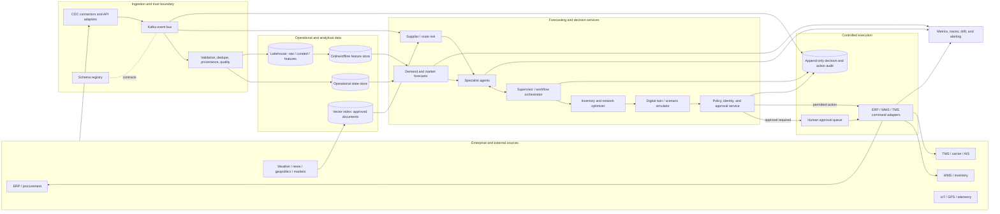

# NexusSC: Self-Evolving Supply Chain Control Plane

NexusSC is a prototype mission-control dashboard for exploring how a governed,
multi-agent system could sense supply-chain changes, forecast their impact, and
recommend or execute bounded responses. This document describes a practical
target architecture; it does not claim that the current prototype already
provides production-grade forecasting, autonomous planning, or ERP execution.

## Assumptions and design principles

- The organization has multiple regions, suppliers, distribution centers,
  transport modes, and planning horizons. The first deployment is for one
  product family and a bounded set of lanes, sites, and suppliers.
- An existing ERP remains the system of record for orders, inventory,
  suppliers, and finance. WMS, TMS, procurement, and carrier systems remain
  authoritative for their respective operational records.
- The initial system is decision support. It may automate low-risk,
  reversible actions only after explicit policy approval and a measured pilot.
- Forecasts and recommendations include provenance, freshness, uncertainty,
  and constraints. An LLM can interpret unstructured evidence, but it is not
  the source of truth for inventory, prices, permissions, or commitments.
- All service-level objectives, approval limits, risk tolerances, and
  deployment timelines below are proposed design inputs. The business and
  control owners must set them from operating requirements and baseline data.

## 1. Architecture



### Agent responsibilities

Agents are bounded services with typed inputs and outputs. They propose
decisions; a deterministic policy and optimizer decide whether a proposal is
feasible and permitted.

| Agent | Inputs | Outputs | Tools and autonomy boundary |
|---|---|---|---|
| Demand forecasting | Orders, POS, promotions, price, calendar, product hierarchy, forecast features | Forecast distributions by SKU/site/time bucket, quantiles, uncertainty, drivers | Time-series model service and feature store; cannot change the demand plan directly |
| Procurement | Approved demand, supplier quotes, contracts, capacity, lead times, risk and policy limits | Ranked sourcing options, quote requests, draft purchase requisitions | ERP procurement adapter and constrained sourcing optimizer; purchase orders require approval until explicitly delegated |
| Inventory / MEIO | Inventory position, open orders, demand and lead-time distributions, service targets, shelf-life and capacity | Reorder points, safety-stock proposals, transfer plans, expected service/capital trade-offs | Inventory optimizer; writes require policy checks and are initially recommendations |
| Logistics / routing | Orders, shipment milestones, carrier capacity, routes, port status, weather and constraints | Feasible modes/routes, revised ETA, booking or reroute proposal | TMS/carrier adapters and routing solver; cannot dispatch outside contracted lanes or delegated limits |
| Supplier risk | Supplier/sub-tier graph, quality, delivery, financial, news, sanctions and geopolitical evidence | Time-stamped risk indicators, evidence links, affected SKUs/sites, confidence | Rules, graph queries and approved retrieval; LLM extracts claims but does not issue sanctions determinations |
| Pricing / market | Demand forecast, costs, FX, commodity prices, competitor or market signals where licensed | Scenario-based price/margin recommendation and confidence | Forecasting and pricing optimizer; no customer-facing price change without commercial approval |
| Supervisor / orchestrator | Events, agent proposals, policies, workflow state, priorities and deadlines | Task assignments, conflict resolution, plan proposal, approval request or permitted command | Durable workflow engine, policy service and optimizer; cannot bypass constraints or create its own permissions |

### Communication, shared state, and negotiation

- Use Kafka (or a compatible managed event broker) for durable domain events.
  Define versioned schemas in a registry. Suggested topics include
  `inventory.position.v1`, `orders.changed.v1`, `shipment.milestone.v1`,
  `supplier.risk.v1`, `forecast.updated.v1`, `plan.proposed.v1`,
  `approval.requested.v1`, and `action.result.v1`.
- Every message carries `event_id`, `event_type`, `schema_version`,
  `occurred_at`, `observed_at`, `source`, `entity_id`, `correlation_id`,
  `causation_id`, `tenant_or_business_unit`, and data-quality/provenance
  metadata. Commands additionally include an idempotency key, expiry,
  authorization context, and expected state version.
- Treat delivery as at-least-once. Consumers deduplicate by `event_id` or
  idempotency key, handle out-of-order events using event time and entity
  version, and use an outbox/inbox pattern around database transactions.
  Acknowledge that exactly-once side effects across ERP boundaries are not
  generally guaranteed; reconcile command results against system-of-record
  state.
- Operational state lives in a transactional database, not in an agent's
  conversational context. A lakehouse stores historical raw and curated
  events; an online/offline feature store serves consistent model features.
  An optional vector index contains access-controlled, versioned documents
  with source citations and retention rules.
- Agents negotiate through structured proposals and counterproposals, not
  free-form chat as the control protocol. Each proposal declares objective,
  affected entities, assumptions, constraints, cost/service/risk effects,
  confidence, expiry, and required approvals. The orchestrator resolves
  conflicts using deterministic business priorities and optimization.

## 2. Real-time operation

### Ingestion and event processing

1. Use CDC (for example, Debezium where supported) for ERP/WMS/TMS database
   changes; use authenticated webhooks or polling adapters for SaaS systems;
   use MQTT or an IoT gateway for device telemetry; ingest licensed external
   feeds through isolated adapters.
2. Kafka provides partitioned, replayable event transport. Partition by a
   stable key such as order, shipment, SKU/site, or supplier so related state
   transitions can be processed in order. Use a stream processor such as Flink
   for windows, joins, late events, and derived signals.
3. Validate schema, units, identity mapping, event time, freshness, and
   plausibility at ingestion. Quarantine invalid or suspicious records;
   preserve the raw record and report the reason instead of silently
   substituting a normal-looking value.
4. Publish normalized domain events and update operational projections.
   Trigger planning workflows from material changes, not every raw sensor
   sample. Debounce repeated alerts, group affected orders, and use severity
   and time-to-impact to prioritize work.

### Disruption response and timing

The response-time objective should be measured from event receipt to a
validated, actionable plan; it is not a guarantee that a supplier or carrier
can execute in that time. Set per-lane SLOs after measuring the existing
process.

| Trigger | Immediate response | Replanning scope |
|---|---|---|
| Port delay or closure | Corroborate with carrier/port evidence; estimate affected ETAs and confidence; identify shipments at risk | Recompute feasible routes, allocations, inventory coverage, and customer priorities for impacted lanes and SKUs |
| Supplier failure or capacity cut | Confirm the supplier, effective date, affected parts, open POs, and sub-tier dependencies | Re-run constrained multi-sourcing, available-to-promise, substitution, and inventory allocation |
| Demand spike or drop | Detect a change against forecast and seasonality; separate true demand from duplicate orders or promotion effects | Reforecast affected SKU/regions; evaluate capacity, replenishment, allocation, and pricing options |

Use a tiered workflow: (1) deterministic event classification and impact
calculation, (2) bounded optimization on the affected subgraph, (3) scenario
comparison, (4) policy and approval decision, (5) command execution with
idempotency, and (6) confirmation/reconciliation. If optimization exceeds its
deadline or required inputs are stale, return a clearly marked incomplete
recommendation or existing approved fallback plan and escalate; do not present
an unverified plan as a successful action.

## 3. Market-shift prediction

### Modeling strategy

- Establish transparent baselines first: seasonal naive, moving averages,
  exponential smoothing, and Prophet where calendar/seasonality structure
  supports it. Compare with global or hierarchical models such as gradient
  boosting and Temporal Fusion Transformer for multiple related series. Use
  LSTMs only where they beat a simpler baseline in rolling backtests and are
  maintainable. Model choice depends on data volume, horizon, cadence, and
  intermittency.
- Train separate forecasts for operational demand, supplier lead time,
  commodity/FX exposure, and market indicators. Avoid treating a correlated
  public ticker as a causal driver without validation.
- Use LLMs on licensed, timestamped news and analyst documents to extract
  structured claims: entities, event type, direction, expected duration,
  geography, cited source spans, and publication time. Resolve entities
  against an approved master-data graph. Retrieval-augmented generation may
  summarize evidence but must return citations and abstain when evidence is
  weak. Never let an LLM invent numeric time-series observations.
- Add anomaly detectors for data-quality incidents and regime shifts
  (robust statistical limits, change-point detection, or an isolation model).
  An anomaly is a review/forecast trigger, not by itself proof of a disruption.

### Signal fusion, confidence, and evaluation

Fuse features at a defined entity and horizon (for example, SKU-region-week
or lane-day) using a calibrated ensemble or a downstream model trained only
on time-available features. Preserve component forecasts and provenance.
Confidence should be empirically calibrated from out-of-sample residuals and
include data freshness, disagreement between models, coverage, and source
quality; it is not an LLM's self-reported confidence. Emit prediction
intervals or quantiles, not only a point estimate.

Evaluate with rolling-origin backtests and leakage-safe temporal splits. Track
WAPE or MASE alongside bias and service-impact measures; avoid MAPE for series
with zero or near-zero actuals. For probabilistic forecasts, track pinball
loss and interval coverage. Compare against the current planning baseline by
SKU class, site, horizon, and disruption regime. Maintain a model registry,
versioned features, reproducible training data snapshots, champion/challenger
reports, and drift alarms. Promote a model only after owners review measured
results and operational impact.

## 4. Self-evolution

Self-improvement changes are proposals to a controlled release process; live
agents must not rewrite and deploy their own code or permissions.

1. **Observe outcomes:** Join each recommendation and action to later
   outcomes (forecast error, realized lead time, cost, service, overrides,
   and data-quality state) using stable decision and action IDs.
2. **Create reward/feedback:** Define a business-approved, constrained
   objective such as service and cost trade-offs. Penalize policy violations,
   unsafe actions, poor calibration, and excessive human overrides. Do not
   optimize a single proxy such as cost if it can degrade service or fairness.
3. **Improve offline:** Retrain forecasting models on governed datasets.
   Tune prompts, thresholds, and policy parameters offline with versioned
   evaluation sets. Consider contextual bandits or reinforcement learning
   only after reliable action/outcome logging and a validated simulator exist;
   begin with offline evaluation, not unrestricted online exploration.
4. **Evaluate safely:** Run candidates in unit/property tests, historical
   replay, stress scenarios, and a restricted sandbox with no production
   credentials or network egress. Then run shadow mode (no actions), followed
   by a limited canary with explicit cohort, exposure cap, kill switch, and
   rollback target.
5. **Promote or retire:** Require statistical and operational acceptance
   criteria, security and model-risk review, and named owner approval.
   Spawn or retire an agent only through a reviewed deployment change with
   scoped identity, resource limits, health checks, and an audit trail.

## 5. Governance and safety

- **Autonomy tiers:** Start in observe-only mode; move to recommendation;
  then human-approved execution; permit bounded automation only for
  reversible, low-impact actions whose policies and rollback path have been
  explicitly approved. Define monetary, volume, service, and time limits by
  business unit.
- **Approval:** Route actions above delegated limits, involving regulated or
  strategic suppliers, changing customer commitments, using substitutions,
  or with low/stale confidence to an authorized human. Require separation of
  duties for high-impact overrides.
- **Hard constraints:** Enforce sanctions/export restrictions, contract
  terms, supplier qualification, product compatibility, capacity, shelf life,
  budget, customer priority, and segregation-of-duty rules in deterministic
  services outside the LLM. A failed or unavailable guard blocks execution.
- **Hallucination controls:** Ground external claims in retrieved sources;
  require citations and freshness; use typed schemas and validation; restrict
  tools to allowlists; require an optimizer or system-of-record lookup for
  quantities and commitments. Agents cannot execute arbitrary SQL or shell
  commands.
- **Cascade and loop controls:** Use bounded retries, workflow deadlines,
  per-entity locks/version checks, circuit breakers, rate limits, deduplication,
  action budgets, and a global kill switch. Detect oscillating recommendations
  and require cooldown or supervisor review.
- **Adversarial inputs:** Authenticate producers, validate signatures where
  available, quarantine anomalous telemetry, defend document retrieval from
  prompt injection by treating content as untrusted data, and prevent external
  text from changing system instructions or permissions.
- **Audit and explainability:** Store the triggering events, source versions,
  model/prompt/policy versions, features, alternatives, objective and
  constraints, approval identity, command idempotency key, adapter response,
  and final reconciled state. Use append-only or tamper-evident retention
  appropriate to legal requirements. Provide an operator-readable reason and
  evidence links for each material recommendation.
- **Security and privacy:** Use workload identity, least privilege, secrets
  management, encryption, tenant/business-unit isolation, retention limits,
  and data-loss controls. Complete privacy, security, model-risk, and
  regulatory reviews for each deployment geography.

## 6. Recommended technology stack

Choose managed services that fit the organization's cloud, procurement,
residency, and existing platform standards. This is a reference stack, not a
vendor requirement.

| Layer | Practical starting choice | Notes |
|---|---|---|
| Event streaming | Kafka-compatible managed service; Schema Registry | Use CDC/webhook/IoT adapters; define ownership and retention per topic |
| Stream processing | Flink or Kafka Streams | Event-time joins, late data, dedupe, impact windows |
| Workflow/orchestration | Temporal for durable workflows; LangGraph for bounded LLM workflows | Keep business process state durable; use one agent framework initially rather than combining several |
| Agent services | Python, FastAPI, typed Pydantic contracts | Each agent is a separately permissioned service or bounded worker |
| Optimization | OR-Tools for initial LP/MIP; commercial solver if validated needs justify it | Keep hard constraints and objective calculations deterministic and testable |
| Forecasting | Python, statsmodels/Prophet and scikit-learn baselines; PyTorch for validated deep models | Track data/features/model versions in MLflow or an equivalent registry |
| Operational store | PostgreSQL or existing enterprise database | Authoritative workflow projections, approvals, and idempotency records |
| Analytics/lakehouse | Object storage with Iceberg/Delta tables and Spark/dbt as appropriate | Keep immutable raw data separate from curated data |
| Feature store | Feast or existing cloud feature service | Only add if online/offline feature consistency is required |
| Document retrieval | pgvector for a small initial corpus; managed vector service if scale/security needs demand it | Enforce ACLs, provenance, deletion, and citation metadata |
| Deployment | Kubernetes or the organization's managed container platform; Terraform | Separate dev/staging/prod, autoscaling, secrets, network policy, and rollback |
| Observability | OpenTelemetry, Prometheus/Grafana, centralized logs and tracing | Monitor service health, event lag, model quality, cost, and action outcomes |
| LLM provider | Approved hosted model or private deployment through a model gateway | Pin versions, log safe metadata, set token/time budgets, and retain provider portability |

CrewAI, AutoGen, and LangGraph are alternatives for agent orchestration.
Select based on durable workflow support, observability, access control,
testing, and team expertise. The LLM framework must not own the final
authorization decision.

## 7. Implementation roadmap

Timelines are planning ranges, not delivery commitments. Each phase exits only
when its data, operational, security, and KPI acceptance criteria are met.

| Phase | Indicative duration | Deliverables and exit gate |
|---|---:|---|
| 0. Discovery and controls | 2–4 weeks | Select product family/lanes; map system owners and data rights; baseline service/cost; document decision rights, constraints, and incident process |
| 1. Data foundation and MVP | 6–10 weeks | Read-only ERP/WMS/TMS and selected external feeds; event contracts and quality dashboard; one demand/lead-time baseline; scenario impact view; human-reviewed recommendations; no autonomous writes |
| 2. Shadow pilot | 8–12 weeks | Operate for selected sites/lanes; compare forecasts and plans with current process; record overrides and outcomes; test replay, failure handling, security, and audit; meet jointly agreed acceptance criteria |
| 3. Bounded execution pilot | 8–16 weeks | Enable one reversible action class with value/volume limits, approval routing, reconciliation, kill switch, canary, and rollback; expand only after operational sign-off |
| 4. Scale and governed adaptation | Ongoing, incremental | Add products/regions and agent capabilities; improve models with measured data; shadow-test policy candidates; periodic model, security, and business reviews |

**Core team:** product owner/supply-chain process lead, solution architect,
data engineer, integration engineer, ML/forecasting engineer, optimization
specialist/operations researcher, backend/platform engineer, SRE, security and
privacy representatives, and operational planners for acceptance testing.
Involve ERP/WMS/TMS owners and legal/compliance early; their availability is a
dependency, not a late-stage sign-off.

## 8. KPIs and ROI

Record a pre-pilot baseline and compare on equivalent product/site/horizon
cohorts. Report both aggregate results and tail cases; segment by disruptions
and data completeness. Do not claim ROI until finance validates the benefit
calculation and implementation/run costs.

| KPI | Suggested definition |
|---|---|
| Forecast accuracy | WAPE or MASE by SKU/site/horizon, plus signed bias and probabilistic interval coverage |
| On-time delivery | Orders or shipment lines delivered by the committed date divided by eligible delivered orders/lines; freeze denominator and date semantics |
| Inventory turnover | Cost of goods sold over average inventory value for a stated period; pair with service and obsolescence |
| Stockout / fill rate | Demand fulfilled immediately divided by eligible demand; state whether line-, unit-, or order-based |
| Total supply-chain cost | Agreed landed cost including freight, expedite, duties, inventory carrying cost, and penalties, avoiding double counting |
| Disruption recovery time | Time from verified disruption to restored agreed service level; record disruption start and recovery rule |
| Plan adoption | Recommendations accepted, modified, or rejected, with reason and role; not a success KPI alone |
| Decision latency | Event receipt to validated plan and, separately, approval and reconciled action |
| Data quality | Completeness, freshness, duplicate rate, identity-match rate, and quarantined-event rate by source |
| Safety | Unauthorized actions, policy blocks, rollback events, reconciliation failures, and near misses; target and escalation rules set by governance |

Estimate ROI from validated changes in inventory carrying cost, expediting,
lost sales, labor, and disruption losses, minus integration, cloud/model,
licensing, support, and change-management costs. Avoid attributing market or
seasonality changes to the system without an appropriate comparison method.

## 9. Risks and mitigations

| Risk | Mitigation |
|---|---|
| Incomplete, late, duplicated, or inconsistent source data | Data contracts, freshness indicators, entity resolution, quarantine, reconciliation, lineage, and explicit degraded mode |
| Forecast/model drift and rare disruptions | Rolling backtests, champion/challenger, calibrated intervals, stress tests, human review, and conservative fallback policies |
| Agent latency, event backlog, or external API outage | Managed buffering, deadlines, circuit breakers, cached data labeled with age, bounded retries, and prioritize urgent affected entities |
| LLM hallucination or prompt injection | Treat documents as untrusted, require citations, validate typed outputs, restrict tools, and keep deterministic controls outside the model |
| Unsafe autonomous actions or cascading plans | Staged autonomy, hard limits, simulation/reconciliation, idempotency, approval gates, canary, kill switch, and rollback |
| Cloud, model, or data-provider cost | Per-workflow budgets, model routing, caching, token/compute limits, usage metering, and periodic cost reviews |
| Privacy, trade-secret exposure, sanctions, or residency violations | Data classification, least privilege, approved regions/providers, retention controls, legal review, and restricted model inputs |
| Integration complexity and vendor lock-in | Versioned domain events, adapter interfaces, portable storage formats, infrastructure as code, exportable model artifacts, and tested exit plans |
| Low operator trust or poor adoption | Co-design workflows, show alternatives and evidence, capture override reasons, train users, and measure time saved and outcomes |
| False causal interpretation | Separate correlation from intervention claims; use causal designs only with justified assumptions and validate against observed outcomes |

## End-to-end example: strike at an Asian port

1. A carrier milestone and a trusted port alert report a possible strike.
   The ingestion service records both with source, observed time, and quality
   status; duplicate or contradictory reports are retained and flagged.
2. The disruption workflow checks carrier/port corroboration and the
   organization's supplier-to-port-to-shipment graph. It identifies open
   shipments, dependent SKUs, downstream sites, and inventory coverage.
3. Supplier-risk and logistics services return evidence-linked impact
   estimates and feasible alternatives. Demand forecasting provides
   uncertainty-aware demand over the affected lead-time horizon. The
   orchestrator requests re-planning only for the impacted network slice.
4. The inventory optimizer compares options such as alternate port, alternate
   qualified supplier, inventory transfer, allocation by approved priority,
   or waiting for confirmation. Each option includes feasibility, estimated
   cost/service trade-offs, assumptions, confidence, and source timestamps.
5. Deterministic policies reject options that violate contracts, qualification,
   capacity, budget, sanctions, or customer constraints. If evidence is stale,
   models disagree materially, or the action exceeds delegated authority, the
   system presents alternatives for planner approval rather than dispatching.
6. An authorized planner approves or edits the selected plan. The command
   adapter sends an idempotent TMS/ERP request, records the response, and
   reconciles against the system of record. Failure or mismatch raises an
   actionable alert; it is not reported as committed.
7. The system tracks realized arrival, cost, service, and overrides. These
   outcomes update evaluation datasets; a future model or policy change is
   proposed offline and must pass shadow/canary gates before promotion.

## Current prototype: implemented versus proposed

The repository currently contains a React/Vite dashboard and an Express
telemetry proxy. The map, scenario controls, KPI changes, agent message stream,
causal controls, evolution animation, and safety ledger are primarily
front-end simulation/sample data. The “mutation” flow does not synthesize,
execute, or validate a real policy; the ledger does not commit to an ERP.

The server and client attempt selected public telemetry fetches (weather,
USGS earthquake data, FX via Frankfurter, and market data via Yahoo Finance).
Availability and licensing vary by provider; fallback values are not live
observations and should be labeled as such. These feeds are not a streaming
platform and do not currently drive a production optimization or actuation
workflow.

The architecture above is a proposed path from this demonstrator to a
production system. Implement integrations, model services, authorization,
durable state, audit controls, and human approval before claiming autonomous
operations.

## Local development

```bash
npm install
npm run dev
```

The Vite development server serves the UI (normally at
`http://localhost:5173`). For a production build and local Express server:

```bash
npm run build
npm start
```

The production server listens on `PORT` or port `3000` and serves the built UI
from `dist`.

## Deployment

Deploy the built application and Express server using the organization's
approved container or managed Node.js platform. Configure `PORT`, health
checks, TLS termination, logging, and provider/network access in the hosting
environment. For a Railway deployment, connect the GitHub repository, confirm
that the build runs `npm run build`, the start command is `npm start`, and the
service exposes the configured port; deployment configuration can differ by
project and should be verified in Railway before production use.
